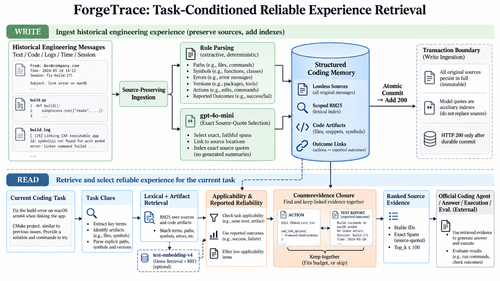
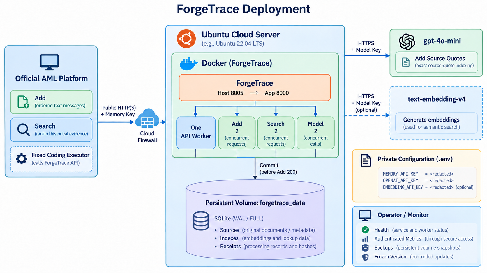

# ForgeTrace

**Task-Conditioned Reliable Experience Retrieval for Coding Agents**

ForgeTrace is a persistent memory service for historical software engineering experience. It stores code, debugging traces, proposed changes, and reported test outcomes, then retrieves source-grounded evidence for a new coding task.

Designed for the **Agent Memory Challenge Cycle 2 Coding track**, ForgeTrace implements Add and Search. The competition platform runs the downstream coding agent, code execution, and evaluation.

## Submission Summary

| Item | Specification |
| --- | --- |
| System | **ForgeTrace** |
| Implementation version | `0.1.0` |
| Target track | Coding Agent Memory |
| Intended division | Open-source Methods, subject to organizer review |
| Write interface | Synchronous `POST /add` |
| Retrieval interface | `POST /search` |
| Production LLM | `gpt-4o-mini` for exact-source quote selection during Add |
| Default embedding configuration | Disabled |
| Optional embedding | `text-embedding-v4` |
| Storage | SQLite FTS5, WAL, `synchronous=FULL` |
| License | MIT |

The submitted service stores and retrieves historical engineering evidence. It does not access an implicit repository filesystem, execute the official task, or generate a new solution as memory. Runtime configuration, model providers, and externally verified endpoint URLs must match the registered submission version.



## Overview

Historical engineering records contain useful fixes alongside failed attempts, outdated dependencies, unrelated errors, and unverified suggestions. Semantic or lexical similarity alone cannot establish whether an earlier action applies to the current task.

ForgeTrace separates three signals:

- **Relevance:** Does the source discuss the current task, file, symbol, or error?
- **Applicability:** Do its explicit paths and version constraints match?
- **Reported support:** Does the history contain a supporting, failing, or conflicting outcome report?

Its evidence-selection mechanism, **Counterevidence Closure**, keeps an action and its known linked reports together. If the complete evidence packet exceeds the response budget, the packet is skipped rather than returning the action without its failure context.

This is a bounded engineering design, not a proof that a historical fix is correct. A textual report of passing tests is not independently verified execution.

## Validation and Evaluation Status

| Component | Recorded status |
| --- | --- |
| Add/Search, parsing, storage, isolation, and recovery tests | **112 tests passed** |
| Docker validation | Passed with **1.5 CPU / 1 GiB**, including restart and SIGKILL recovery |
| Persistent-storage capacity diagnostic | **100,000 source messages** written and retrieved after reopening |
| Synthetic retrieval and ablation experiments | Completed across three data seeds |
| Real Mini / embedding evaluation | Not run; credentials were not configured |
| Public cloud deployment and official Smoke/Full | Not established by the recorded local validation |

These are local results. They do not establish official CAMBench performance or production model latency. See [Experiments](EXPERIMENTS.md) for the original records and limitations.

## Method

### Memory Writing

```text
Ordered engineering messages
    -> Input validation and idempotency check
    -> Full-source preservation
    -> Rule-based engineering parsing
       + Bounded gpt-4o-mini source-quote selection
    -> Source spans, lexical indexes, code artifacts, and outcome links
    -> Atomic SQLite commit
    -> Add HTTP 200
```

- Preserve complete source text, message order, roles, session identifiers, and optional timestamps.
- Extract file paths, symbols, exceptions, versions, actions, code/diff spans, and reported outcomes.
- Validate model-selected quotes against exact source substrings.
- Store sources losslessly; model input sampling does not replace or truncate the stored originals.
- Commit sources, indexes, links, and the idempotency receipt in one transaction.

Production mode makes **one logical Mini request per new Add batch**, with bounded retries. It does not make a separate model request for every log chunk. The model view is limited to selected source snippets; complete lexical indexing still covers the original messages.

### Memory Retrieval

```text
Current coding task
    -> Path, symbol, error, and version clues
    -> User-scoped BM25 and artifact retrieval
    -> Applicability and reported-reliability ranking
    -> Counterevidence Closure
    -> Ranked historical source evidence
    -> Official coding agent / execution / evaluation
```

Search returns deterministic provenance headers and exact source excerpts. It does not generate a new patch or present a predicted solution as historical memory.

The default retrieval path uses no remote model calls. Optional dense retrieval uses `text-embedding-v4` and reciprocal rank fusion (RRF).

### Storage and Isolation

- SQLite **WAL** with **synchronous=FULL**.
- Add succeeds only after the sources and immediately usable indexes are committed.
- Idempotent retries are scoped by `user_id` and `request_id`.
- Reusing a request ID with a changed payload returns HTTP 409.
- Lexical statistics are computed per user; another user's writes do not change the current user's ranking.
- Frozen method/configuration fingerprints prevent silently reopening a database with incompatible settings.

See [METHOD.md](METHOD.md) for algorithms, source-span representation, failure cases, and novelty boundaries.

## Requirements

- Python **3.11** recommended.
- SQLite with **FTS5** support.
- Linux or WSL for the documented deployment commands.
- Docker Engine and Compose for container deployment.
- **No GPU required.**

Runtime dependencies are pinned in [requirements.lock](requirements.lock). Development dependencies are listed in [requirements-dev.txt](requirements-dev.txt).

### Model Configuration

| Setting | Behavior |
| --- | --- |
| `MODEL_MODE=gpt-4o-mini` | Production default; requires `OPENAI_API_KEY` |
| `MODEL_MODE=offline` | Local diagnostics without LLM requests |
| `EMBEDDING_MODE=none` | Default; no embedding requests |
| `EMBEDDING_MODE=v4` | Optional `text-embedding-v4` baseline; requires provider configuration |

Offline mode is not a claim of eligibility for the Open-source Methods division. Check the recorded [competition contract](docs/competition_contract.md) and obtain any required organizer confirmation before submitting.

## Installation and Local Run

Run the following from an existing checkout or extracted source archive:

```bash
python3 -m venv .venv
. .venv/bin/activate
python -m pip install -r requirements-dev.txt

export PYTHONPATH="$PWD/src"
export MODEL_MODE=offline
export MEMORY_DB_PATH=data/local-diagnostic.sqlite3
read -rsp 'Choose a local Memory System Key: ' MEMORY_API_KEY
printf '\n'
export MEMORY_API_KEY

python -B -m forgetrace.api
```

The local service listens on `http://127.0.0.1:8000` by default. Keep this terminal running. In another terminal, activate the same environment and enter the same key:

```bash
. .venv/bin/activate
read -rsp 'Memory System Key: ' MEMORY_API_KEY
printf '\n'
export MEMORY_API_KEY

python -B scripts/smoke_test.py \
  --base-url http://127.0.0.1:8000 \
  --state state-local.json
```

This is a synthetic API self-check, not the official competition Smoke. Use a separate database for production because model and method settings are bound to the database configuration.

## Docker Deployment



Follow the [deployment guide](docs/deployment_guide.md) to verify the source commit or ZIP manifest. Create a private environment file without overwriting an existing one:

```bash
if [ ! -f .env ]; then cp .env.example .env; fi
chmod 600 .env
```

Configure `.env` with your actual credentials and fixed project commit:

```dotenv
MEMORY_API_KEY=<your-private-memory-system-key>
MODEL_MODE=gpt-4o-mini
OPENAI_API_KEY=<your-private-model-provider-key>
OPENAI_BASE_URL=https://api.openai.com/v1
EMBEDDING_MODE=none
SOURCE_COMMIT=<your-fixed-project-commit>
PUBLIC_PORT=8000
```

Replace all placeholders. Never commit `.env` or place credentials in the Dockerfile.

```bash
chmod 600 .env
sh scripts/deploy.sh

docker compose ps
docker compose logs --tail 100 memory
curl --noproxy '*' --connect-timeout 5 http://127.0.0.1:8000/health
```

| Deployment setting | Default in the supplied template |
| --- | --- |
| Host port / container port | `8000` / `8000` |
| Container | `forgetrace` |
| Persistent volume | `forgetrace_data` |
| API workers | `1` |
| Add / Search / model concurrency | `2` / `2` / `2` |
| Container resources | `1.5 CPU`, `1 GiB RAM` |
| Request / response body limit | `8 MiB` / `16 MiB` |

The request limit applies to the complete serialized JSON body, including escaping and metadata. Independent diagnostics accepted two simultaneous 8 MiB source texts under a higher receive limit, with a peak cgroup memory usage of approximately 500.5 MiB. This does not establish safe handling of 64 MiB requests.

The optional dense baseline is limited to **50,000 indexed chunks per user**. Capacity is checked before successful writes. The default configuration has embeddings disabled and does not impose that vector-specific limit.

## API

Authentication supports:

```http
Authorization: Token <Memory System Key>
```

`Authorization: Bearer` and `X-Api-Key` are also supported. The Memory System Key authenticates this service; the model-provider key authenticates outbound model requests. The official Eval Key is a separate platform credential.

### Add: `POST /add`

```bash
FORGE_URL='http://127.0.0.1:8000'

curl -sS "$FORGE_URL/add" \
  -H "Authorization: Token $MEMORY_API_KEY" \
  -H 'Content-Type: application/json' \
  --data '{
    "request_id": "manual-check-1",
    "user_id": "manual-check",
    "session_id": "s1",
    "messages": [{
      "role": "user",
      "content": "Action: guard None in src/auth.py get_user_by_id. Tests passed."
    }]
  }'
```

Expected acknowledgment:

```json
{
  "success": true,
  "request_id": "manual-check-1",
  "user_id": "manual-check",
  "session_id": "s1"
}
```

Each message uses string `content` and a `user` or `assistant` role. An optional `timestamp` is an integer in Unix milliseconds. HTTP 200 means the transaction has committed and the evidence is immediately searchable.

### Search: `POST /search`

```bash
curl -sS "$FORGE_URL/search" \
  -H "Authorization: Token $MEMORY_API_KEY" \
  -H 'Content-Type: application/json' \
  --data '{
    "query": "src/auth.py get_user_by_id None",
    "user_id": "manual-check",
    "top_k": 100
  }'
```

The response contains a `data` array. Each item has a stable `id` and nonempty textual `content`; this implementation also supplies `score` and `created_at`. Evidence packets may contain several explicitly attributed source excerpts. `top_k` limits returned items, not the number of source excerpts inside a packet.

`score` is a rank indicator, not a calibrated probability. Queries without matching evidence can return `{"data": []}`.

### Operational Endpoints

- `GET /health`: public service health, version, and runtime source fingerprint.
- `GET /metrics`: authenticated aggregate operational metrics.

The service returns explicit errors for invalid input, authentication failure, changed-payload retries, capacity limits, and upstream failures. It does not acknowledge an uncommitted background write. See the [API contract](docs/competition_contract.md) and [JSON Schema](config/api_contract.schema.json).

## Evaluation and Ablation

```bash
export PYTHONPATH="$PWD/src"
python -B -m unittest discover -s tests -v

python -B scripts/evaluate.py --split eval --count 40 --seed 11 \
  --strategies raw structured proposed \
    no_structure no_reliability no_applicability no_closure \
  --output results/reproduction-seed11.json

python -B scripts/benchmark.py --mode all \
  --output results/local-performance.json
```

Repeat the retrieval experiment with seeds `23` and `37` and distinct output filenames. The evaluation script preserves earlier reports by refusing to overwrite them.

| Variant | Purpose |
| --- | --- |
| `raw` | Original sources and BM25 |
| `structured` | Engineering features and artifact retrieval |
| `proposed` | Applicability, reported reliability, and evidence closure |
| `no_structure` | Disable structured retrieval/ranking and auxiliary quote chunks |
| `no_reliability` | Remove reported-reliability ranking |
| `no_applicability` | Remove explicit applicability-risk ranking |
| `no_closure` | Return ranked sources without linked-report packet assembly |

### Recorded Local Results

The synthetic evaluation uses six authored Python task families and a deterministic consumer that applies the first applicable historical diff, then runs tests once. It is not CAMBench or a general coding agent.

| Noisy condition | Raw | Structured | Proposed |
| --- | ---: | ---: | ---: |
| MRR | 0.50 | 0.50 | 1.00 |
| Recall@5 | 1.00 | 1.00 | 1.00 |
| Harmful source fraction@5 | 0.00 | 0.00 | 0.20 |
| Fixed-consumer execution success | 1.00 | 1.00 | 1.00 |

The proposed method improved ordering and known-report completeness in these fixtures. **It did not improve execution success over the memory baselines, and harmful exposure at rank five was worse.** Queries include strong path, symbol, and version clues, so these results do not establish natural-task generalization or improved official scores. Real embedding/hybrid quality results remain unmeasured.

A separate two-core-affinity, persistent-filesystem diagnostic stored 100,000 messages at approximately **121.28 messages/s**, with Search p95 of **1.352 s** after reopening. This was a direct-store, repetitive synthetic workload with no model calls, not production HTTP throughput or cloud-server performance.

See [EXPERIMENTS.md](EXPERIMENTS.md), [ablation](docs/ablation.md), and the [performance report](docs/performance_report.md) for complete measurements, negative results, and resource limits.

## Competition Submission and Reproduction

The [submission guide](SUBMISSION_GUIDE.md) covers source publication, fixed commits, endpoint registration, authentication, eligibility, official Smoke, and Full evaluation. The [checklist](docs/submission_checklist.md) distinguishes completed local checks from outstanding deployment and competition steps.

Prepare:

- A public source repository and the exact commit used by the deployed service.
- Actual, externally validated Add and Search URLs.
- The private Memory System Key and the matching authentication method.
- Accurate model-provider, capacity, concurrency, timeout, and method disclosures.
- Deployment, reproduction, attribution, and technical documentation.

Do not treat offline validation as official eligibility or an official Smoke result. Verify model availability and organizer requirements before committing evaluation resources. Existing Full jobs must follow the platform's version-freezing and recovery rules; renaming a system does not reset quotas.

### Submission Procedure

1. Freeze the source commit, model configuration, retrieval parameters, and container image.
2. Deploy the service with persistent storage and validate Add/Search from an external network.
3. Register the actual Add/Search URLs, authentication method, private Memory System Key, source repository, and operating limits in the official form.
4. Complete the official Smoke and the required eligibility/capacity checks before starting an authorized Full run.
5. Keep the registered implementation and its stored data consistent throughout the evaluation; follow the official recovery and review process for interrupted jobs.

Provide credentials only through the designated private configuration and submission fields. Do not include the Memory System Key, provider keys, Eval Key, private task data, SQLite files, or operational state in the public repository.

### Reproduction Materials

The repository includes source code, pinned dependencies, API schemas, synthetic data generators, baselines and ablations, tests, Docker configuration, original local result records, and editable architecture diagrams. The [reproducibility document](REPRODUCIBILITY.md) specifies environment and data boundaries. Official private CAMBench execution is performed by the competition platform and is not distributed here.

## Relationship to Earlier Projects

ForgeTrace follows Chronicle-Memory's principles of source preservation, transactions, provenance, isolation, and idempotency. Engineering experience representation, applicability checks, report links, evidence packets, and the Coding-specific service are implemented for this project. It does not reuse a personal-preference schema as a substitute for coding experience.

Service-boundary and deployment components were adapted from the same user's earlier Prism-Swift engineering work. See [ATTRIBUTION.md](ATTRIBUTION.md) for actual reuse, authorization, research references, and novelty limitations.

## Documentation

| Topic | Document |
| --- | --- |
| Method and limitations | [METHOD.md](METHOD.md) |
| Official benchmark analysis | [CAMBench analysis](docs/cambench_analysis.md) |
| API and model-policy evidence | [Competition contract](docs/competition_contract.md) |
| Experiments and negative results | [EXPERIMENTS.md](EXPERIMENTS.md) |
| Reproduction | [REPRODUCIBILITY.md](REPRODUCIBILITY.md) |
| Cloud deployment and recovery | [Deployment guide](docs/deployment_guide.md) |
| Submission procedure | [SUBMISSION_GUIDE.md](SUBMISSION_GUIDE.md) |
| Figures, editable structures, and prompts | [figures/](figures/) |

Some supporting technical documents are currently written in Chinese.

## Acknowledgements

We acknowledge Chronicle-Memory, Prism-Swift, and the research cited in the attribution document. This repository does not distribute private evaluation data, benchmark answers, model weights, or credentials.

## License

Released under the [MIT License](LICENSE). Dependencies retain their respective licenses. Source authorization and provenance are documented in [ATTRIBUTION.md](ATTRIBUTION.md).
